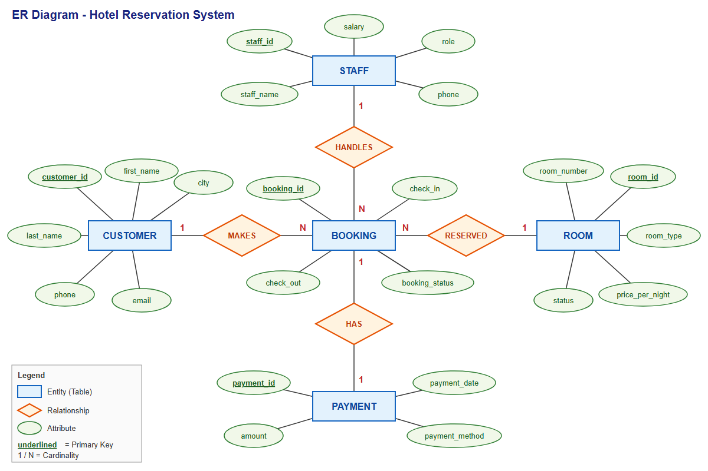
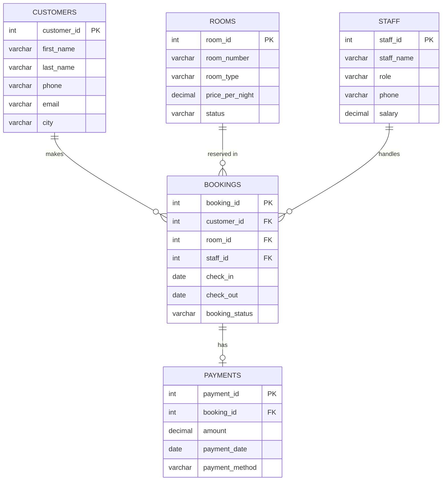
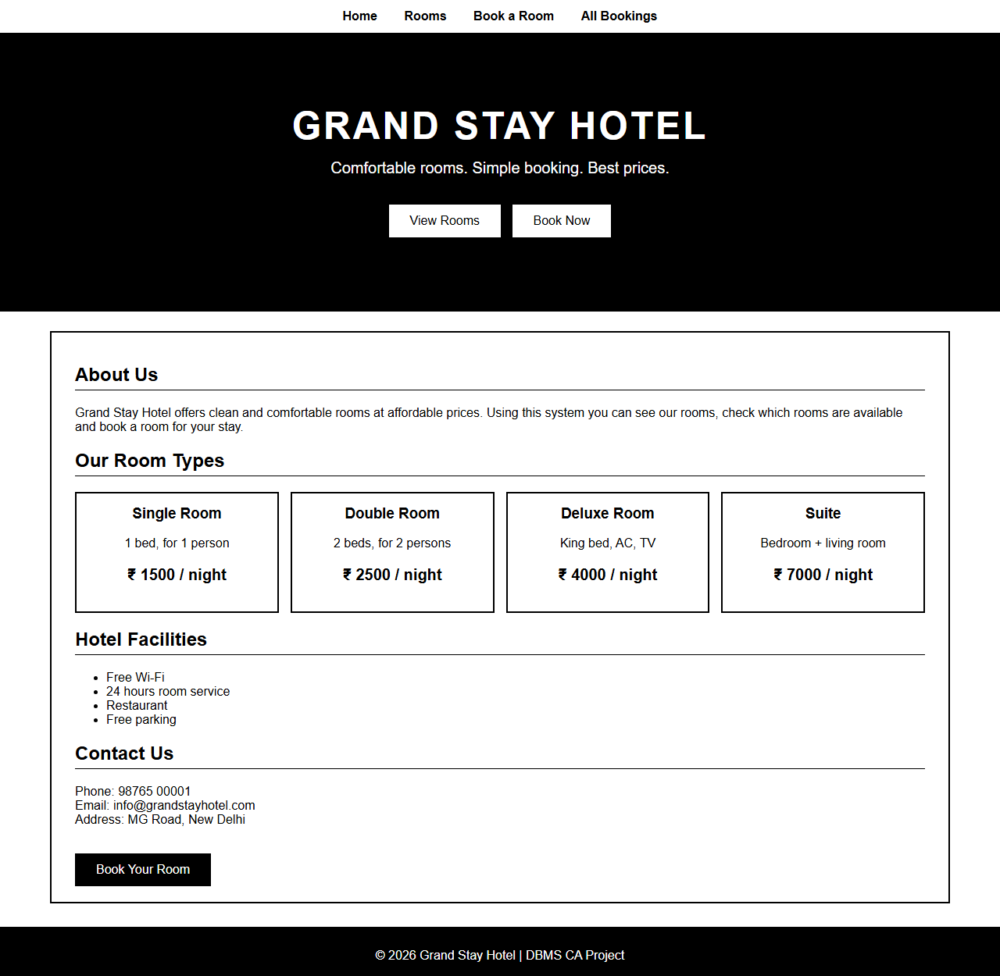
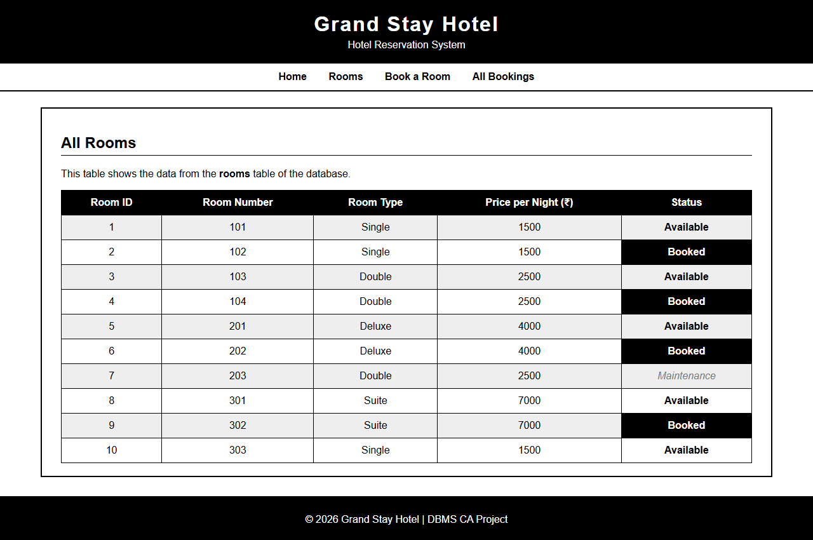
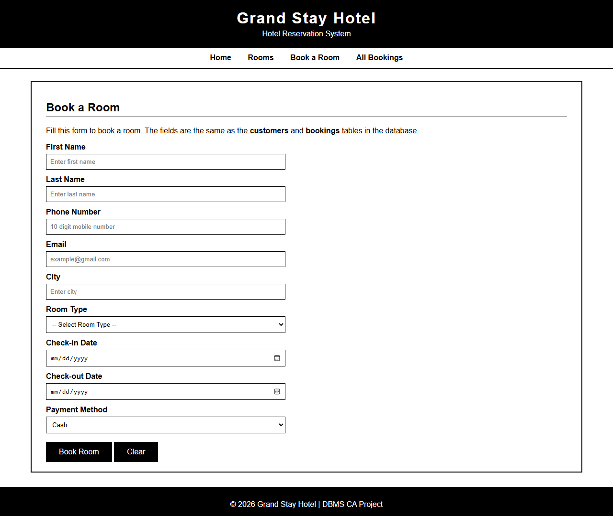
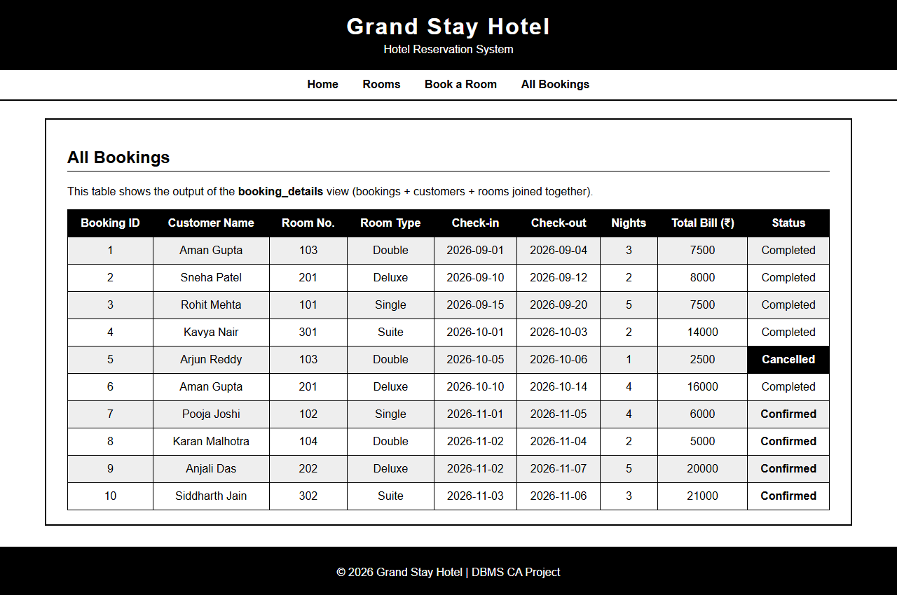

# 🏨 Hotel Reservation System (DBMS CA Project)

A simple **Hotel Reservation System** made with **MySQL** and **basic HTML/CSS**.
It stores information about customers, rooms, staff, bookings and payments, and uses SQL queries to manage and view the data.

> **Subject:** Database Management System (DBMS)
> **Assessment:** CA (Continuous Assessment) Project
> **Name:** _Your Name_
> **Registration No.:** _Your Reg. No._
> **Section / Roll No.:** _Your Section / Roll No._
> **Submitted to:** _Faculty Name_

---

## 📑 Table of Contents
1. [Introduction](#-introduction)
2. [Objectives](#-objectives)
3. [Tools Used](#-tools-used)
4. [Project Structure](#-project-structure)
5. [ER Diagram](#-er-diagram)
6. [Database Tables](#-database-tables)
7. [Relationships](#-relationships)
8. [Normalization](#-normalization)
9. [SQL Queries Covered](#-sql-queries-covered)
10. [Sample Outputs](#-sample-outputs)
11. [HTML Pages](#-html-pages)
12. [How to Run](#-how-to-run)
13. [Conclusion](#-conclusion)

---

## 📖 Introduction
A hotel needs to keep a record of its rooms, guests, bookings and payments.
Doing this on paper is slow and mistakes happen easily. This project stores all of this
data in a **MySQL database**, so the hotel can easily:

- see which rooms are available,
- book a room for a customer,
- calculate the bill,
- and keep a record of payments.

Simple **HTML pages** are also made to show how the front end of the system would look.

---

## 🎯 Objectives
- Design a database for a hotel using an **ER Diagram**.
- Create tables with **Primary Keys, Foreign Keys** and other **constraints**.
- Insert sample data into the tables.
- Write SQL queries using **SELECT, WHERE, ORDER BY, GROUP BY, HAVING, JOINS, Subqueries, Views, UPDATE and DELETE**.
- Make basic HTML pages for the hotel website.

---

## 🛠 Tools Used
| Tool | Purpose |
|------|---------|
| MySQL 8.0 | Database |
| MySQL Workbench / MySQL Command Line | Running SQL queries |
| HTML5 | Web pages |
| CSS | Styling the web pages |
| JavaScript (Canvas) | 3D interactive ER diagram and Story Mode on the Docs page |
| VS Code | Code editor |

---

## 📁 Project Structure
```
Hotel-Reservation-System/
│
├── README.md                  -> Project documentation (this file)
│
├── sql/
│   ├── 01_create_tables.sql   -> Creates database and all tables
│   ├── 02_insert_data.sql     -> Inserts sample data
│   ├── 03_queries.sql         -> All SQL queries (26 queries)
│   └── 04_checkin_story.sql   -> Check-in story (same steps as Story Mode)
│
├── er-diagram/
│   ├── er_diagram.svg         -> ER Diagram (vector image)
│   └── er_diagram.png         -> ER Diagram (PNG image)
│
├── html/
│   ├── index.html             -> Home page
│   ├── rooms.html             -> List of rooms
│   ├── booking.html           -> Room booking form
│   ├── bookings.html          -> All bookings (admin view)
│   ├── docs.html              -> Docs: SQL explained + 3D ER diagram + Story Mode
│   ├── style.css              -> Common CSS for all pages
│   ├── docs.css               -> CSS for the Docs page
│   ├── docs.js                -> SQL colouring, copy buttons
│   └── er3d.js                -> 3D ER diagram + Story Mode (plain JavaScript)
│
└── screenshots/               -> Screenshots of the HTML pages
```

---

## 🧩 ER Diagram



**Entities:** CUSTOMER, ROOM, STAFF, BOOKING, PAYMENT

**Relationships:**
- A **Customer MAKES** many Bookings → **1 : N**
- A **Room** is **RESERVED** in many Bookings (on different dates) → **1 : N**
- A **Staff** member **HANDLES** many Bookings → **1 : N**
- A **Booking HAS** one Payment → **1 : 1**

### Relational Schema Diagram (Crow's Foot)
This diagram is drawn automatically by GitHub using Mermaid.



---

## 🗃 Database Tables

Database name: **`hotel_db`**

### 1. customers
| Column | Data Type | Constraint |
|--------|-----------|-----------|
| customer_id | INT | PRIMARY KEY |
| first_name | VARCHAR(50) | NOT NULL |
| last_name | VARCHAR(50) | |
| phone | VARCHAR(15) | NOT NULL, UNIQUE |
| email | VARCHAR(100) | UNIQUE |
| city | VARCHAR(50) | |

### 2. rooms
| Column | Data Type | Constraint |
|--------|-----------|-----------|
| room_id | INT | PRIMARY KEY |
| room_number | VARCHAR(10) | NOT NULL, UNIQUE |
| room_type | VARCHAR(20) | NOT NULL (Single / Double / Deluxe / Suite) |
| price_per_night | DECIMAL(8,2) | NOT NULL, CHECK (> 0) |
| status | VARCHAR(20) | DEFAULT 'Available' |

### 3. staff
| Column | Data Type | Constraint |
|--------|-----------|-----------|
| staff_id | INT | PRIMARY KEY |
| staff_name | VARCHAR(50) | NOT NULL |
| role | VARCHAR(30) | NOT NULL |
| phone | VARCHAR(15) | |
| salary | DECIMAL(10,2) | |

### 4. bookings
| Column | Data Type | Constraint |
|--------|-----------|-----------|
| booking_id | INT | PRIMARY KEY |
| customer_id | INT | NOT NULL, FOREIGN KEY → customers |
| room_id | INT | NOT NULL, FOREIGN KEY → rooms |
| staff_id | INT | FOREIGN KEY → staff |
| check_in | DATE | NOT NULL |
| check_out | DATE | NOT NULL, CHECK (check_out > check_in) |
| booking_status | VARCHAR(20) | DEFAULT 'Confirmed' |

### 5. payments
| Column | Data Type | Constraint |
|--------|-----------|-----------|
| payment_id | INT | PRIMARY KEY |
| booking_id | INT | NOT NULL, UNIQUE, FOREIGN KEY → bookings |
| amount | DECIMAL(10,2) | NOT NULL |
| payment_date | DATE | NOT NULL |
| payment_method | VARCHAR(20) | (Cash / Card / UPI) |

**Constraints used:** PRIMARY KEY, FOREIGN KEY, NOT NULL, UNIQUE, CHECK, DEFAULT

---

## 🔗 Relationships
| Relationship | Type | How it is done |
|-------------|------|---------------|
| customers → bookings | One to Many | `bookings.customer_id` is a foreign key |
| rooms → bookings | One to Many | `bookings.room_id` is a foreign key |
| staff → bookings | One to Many | `bookings.staff_id` is a foreign key |
| bookings → payments | One to One | `payments.booking_id` is a foreign key + UNIQUE |

---

## 📐 Normalization
The tables are in **Third Normal Form (3NF)**.

- **1NF:** Every column has a single (atomic) value. There are no repeating groups.
  For example, each phone number is stored in its own row, not as a list.
- **2NF:** Every table has a single-column primary key, so there is no partial dependency.
  All columns depend on the full primary key.
- **3NF:** There is no transitive dependency. For example, room price is stored only in the
  `rooms` table and customer details only in the `customers` table. The `bookings` table only
  stores their IDs (foreign keys), not their names or prices again.

The **total bill** is not stored in the bookings table because it can be calculated:
`number of nights × price_per_night`. This avoids repeated (redundant) data.

---

## 🧾 SQL Queries Covered
All queries are in [`sql/03_queries.sql`](sql/03_queries.sql).

| Part | Topic | Queries |
|------|-------|---------|
| A | Basic SELECT, WHERE, ORDER BY, BETWEEN, LIKE, IN | Q1 – Q6 |
| B | Aggregate functions (COUNT, SUM, AVG, MIN, MAX), GROUP BY, HAVING | Q7 – Q12 |
| C | INNER JOIN, LEFT JOIN, DATEDIFF (bill calculation) | Q13 – Q17 |
| D | Subqueries | Q18 – Q20 |
| E | VIEW | Q21 – Q22 |
| F | INSERT, UPDATE, DELETE | Q23 – Q26 |

### Some important queries

**Calculate the bill of each booking (JOIN + DATEDIFF)**
```sql
SELECT b.booking_id,
       c.first_name,
       r.room_number,
       DATEDIFF(b.check_out, b.check_in) AS nights,
       r.price_per_night,
       DATEDIFF(b.check_out, b.check_in) * r.price_per_night AS total_bill
FROM bookings b
JOIN customers c ON b.customer_id = c.customer_id
JOIN rooms r     ON b.room_id = r.room_id;
```

**Customers who never booked a room (LEFT JOIN)**
```sql
SELECT c.customer_id, c.first_name, c.last_name
FROM customers c
LEFT JOIN bookings b ON c.customer_id = b.customer_id
WHERE b.booking_id IS NULL;
```

**Rooms costing more than the average price (Subquery)**
```sql
SELECT room_number, room_type, price_per_night
FROM rooms
WHERE price_per_night > (SELECT AVG(price_per_night) FROM rooms);
```

---

## 📊 Sample Outputs

**Q8. Number of rooms of each type**
```
+-----------+-----------------+
| room_type | number_of_rooms |
+-----------+-----------------+
| Single    |               3 |
| Double    |               3 |
| Deluxe    |               2 |
| Suite     |               2 |
+-----------+-----------------+
```

**Q10. Money collected by each payment method**
```
+----------------+--------------+
| payment_method | total_amount |
+----------------+--------------+
| Card           |     41500.00 |
| UPI            |     30000.00 |
| Cash           |      7500.00 |
+----------------+--------------+
```

**Q14. Bill of each booking**
```
+------------+------------+-------------+--------+-----------------+------------+
| booking_id | first_name | room_number | nights | price_per_night | total_bill |
+------------+------------+-------------+--------+-----------------+------------+
|          1 | Aman       | 103         |      3 |         2500.00 |    7500.00 |
|          2 | Sneha      | 201         |      2 |         4000.00 |    8000.00 |
|          3 | Rohit      | 101         |      5 |         1500.00 |    7500.00 |
|          4 | Kavya      | 301         |      2 |         7000.00 |   14000.00 |
|          5 | Arjun      | 103         |      1 |         2500.00 |    2500.00 |
|          6 | Aman       | 201         |      4 |         4000.00 |   16000.00 |
|          7 | Pooja      | 102         |      4 |         1500.00 |    6000.00 |
|          8 | Karan      | 104         |      2 |         2500.00 |    5000.00 |
|          9 | Anjali     | 202         |      5 |         4000.00 |   20000.00 |
|         10 | Siddharth  | 302         |      3 |         7000.00 |   21000.00 |
+------------+------------+-------------+--------+-----------------+------------+
```

**Q16. Bookings handled by each staff member**
```
+--------------+--------------+------------------+
| staff_name   | role         | bookings_handled |
+--------------+--------------+------------------+
| Rahul Verma  | Manager      |                1 |
| Priya Sharma | Receptionist |                5 |
| Amit Kumar   | Receptionist |                4 |
| Neha Singh   | Housekeeping |                0 |
| Vikram Rao   | Accountant   |                0 |
+--------------+--------------+------------------+
```

---

## 🌐 HTML Pages
These are simple static pages (HTML + CSS only) with a clean **black and white** theme.
They show how the hotel website would look.
The data shown in the tables is the same as the data in the database.

| Page | Description |
|------|-------------|
| `index.html` | Landing page with hotel name, buttons, room types, facilities and contact details |
| `rooms.html` | Table of all rooms with price and status |
| `booking.html` | Form to book a room (fields match the database tables) |
| `bookings.html` | Table of all bookings (same as the `booking_details` view) |
| `docs.html` | Project docs: full SQL explained, live 3D ER diagram and Story Mode |

### 📘 Docs Page (3D ER Diagram + Story Mode)
The **Docs** page (link in the menu, or the *Read the Docs* button on the landing page) explains the whole project:
- **How the system works** – the life of one booking, step by step.
- **3D ER Diagram (live)** – drag to rotate, click a table or relationship to see its columns,
  meaning and SQL, zoom with **+ / −**, and a **Full screen** button. Moving dots show IDs
  flowing between tables through Foreign Keys.
- **Story Mode** – follows a new guest (Riya Kapoor) from arriving to check-out in 10 steps.
  In each step only the tables being used light up, and the page shows the SQL that runs and the
  rows that change. The same SQL is in `sql/04_checkin_story.sql`.
- **All SQL files explained** – every table, constraint and all 26 queries with their outputs,
  an SQL cheat sheet and viva questions.

The 3D diagram is made with plain JavaScript and `<canvas>`. No library or internet is needed.

> Note: The pages are not connected to the database. Connecting them would need a back-end
> language like PHP or Node.js, which is outside the scope of this CA.

### Screenshots

**Landing Page**


**Rooms Page**


**Booking Form**


**All Bookings**


---

## ▶ How to Run

### Run the SQL files
**Option 1 – MySQL Workbench**
1. Open MySQL Workbench and connect to your server.
2. Open `sql/01_create_tables.sql` and click the ⚡ (Execute) button.
3. Open `sql/02_insert_data.sql` and execute it.
4. Open `sql/03_queries.sql` and execute the queries one by one to see the output.
5. (Optional) Open `sql/04_checkin_story.sql` to run the check-in story from the Docs page.

**Option 2 – MySQL Command Line**
Open a terminal in the project folder and log in to MySQL:
```bash
mysql -u root -p
```
Then run the files one by one:
```sql
SOURCE sql/01_create_tables.sql;
SOURCE sql/02_insert_data.sql;
SOURCE sql/03_queries.sql;
SOURCE sql/04_checkin_story.sql;
```

> Run the files **in order** (01 → 02 → 03). Running `01_create_tables.sql` again will
> delete and re-create the database, so you can start fresh anytime.

### Open the HTML pages
Just double-click `html/index.html` to open it in any web browser.

---

## ✅ Conclusion
In this project, a database for a hotel reservation system was designed and created in MySQL.
An ER diagram was made first, and then it was converted into 5 tables with proper keys and
constraints. Sample data was inserted and different types of SQL queries were written to
get useful information, like available rooms, the bill of each booking and the total money
collected. Basic HTML pages were also made to show the front end of the system.

### Future Scope
- Connect the HTML pages to the database using PHP.
- Add a login page for staff.
- Add online payment.

---

⭐ _Made as a DBMS CA project._
